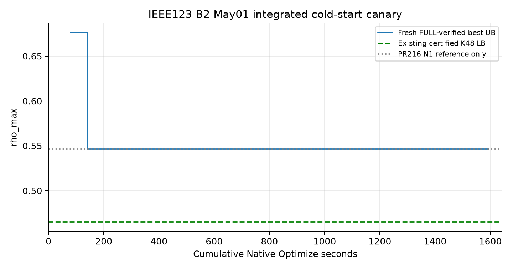
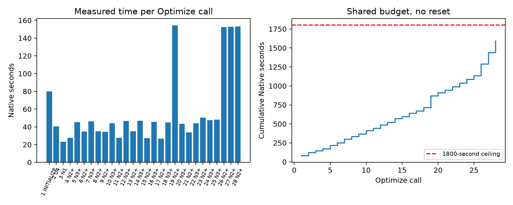

# B2 통합 Primal 1,800초 Cold-Start Canary 최종 보고

판정은 **COLD_START_N1_REPRODUCED**다. 새 Cold Start에서 FULL 검증 UB **0.5461621302242249**을 확보했다. 기존 U4 대비 **19.21317318%** 개선됐지만 N2+/N3+의 추가 경로 이득은 **0**이다. 기존 인증 K48 LB **0.4649848699754817** 대비 Gap은 **14.86321657%**이며 **3% 미달**이다. 최종 이동은 **0회**, Actual은 **ACTUAL_NOT_RUN**이다.

## 1. Source와 실행 범위

Base는 PR216 `38d98b99d1ea5ce9021fe0d727ab80309910b63d`, Source18r은 `497609b46faa14ea7e32a9483a333ab32fd264ef`다. Case SHA `34c0efffa9c05397552fb167667c0bbfe2f35cec89801a3169c00c64fe77f292`, 원본 FULL matrix SHA `0eca025d99a24d2ae91117cdfe3ae48dade189336ada61b3f8234d9bf99f3cec`, domain SHA `9247e42b8119f60ef149d0963e31dd8a697af5426a5aaeec9450b2a2f246481e`를 대조했다. PR207/209/210/211/214/215/216, B1 PR212/213의 HEAD와 보호 증거는 최종 자원·Source 감사에서 유지됐다. 새 연구 브랜치의 독립 Adapter만 추가했다. B1 재개·예약·전체 5월 캠페인·B3·IEEE8500 실행은 0회다.

Source18r의 stationary_paths/values_for에서 초기 이산 대표값을 생성했다. 첫 Native의 실제 NumStart는 0이며 과거 U4/N1 NPZ를 새 Solver Start로 사용하지 않았다. 첫 초기화의 Binary type은 원본대로 유지했다. 과거 continuous fixed-representative 초기화 5.328초와 계산 구성이 다르며, 이번 실측 80.046초를 그대로 예산에 포함했다. 후속 Start는 이번 Canary에서 새로 FULL Replay PASS를 받은 Raw만 사용했다.

## 2. 수학적 영역과 원본 물리

기존 인증 Dense 모델 715,596행 × 354,277열, Binary 9,322개를 그대로 사용했다. 원본 FULL 1,130,336행 × 344,967열로의 역좌표 검증도 기존 PR216 검증기를 사용했다. 초기화는 추가 Hamming 행이 없고 나머지 호출은 1행을 추가했다. Binary 수는 fixed Binary를 포함한 모델 전체 수다.

4대 MESS·24개 위치·96슬롯·97개 SOC 경계·원본 Route DAG/ETA/이동에너지·PCS16·Mode·초기/종단 SOC·이동 중 P/Q 금지와 원본 전체 Grid를 유지했다. Grid에는 전압·Thermal/NormalAmps·변압기·SVR11·Fixed Capacitor·고정 AIDC/PCC가 포함된다. 원본 행·RHS·목적·nonroute 연속 Bounds의 Readback을 검증했다. 차량을 가상 ESS로 합치지 않았다.

N1은 모든 Route/Node/continuous route와 alias를 고정하고 384개 Mode 및 4대 P/Q/SOC를 개방한다. N2+는 1대 Route, N3+는 2대 Route를 개방하며 두 유형 모두 **384개 Mode 전체를 자유롭게** 둔다. Node Hamming만 각각 radius 48/96을 적용하고 Mode 계수는 0이다. 나머지 차량 Route만 고정한다. N1의 radius 384는 모든 Mode 변경을 허용한다.

각 모델은 원본 Bounds 안에서 좌표를 고정하고 Hamming 제약을 추가한 Primal 제한 문제다. 따라서 역좌표에서 가능영역은 원본 FULL의 부분집합이며 새 FULL 중심점은 항상 포함된다. unselected Arc/alias 의존성은 별도로 검사했다. 원본 종단 의미는 slot96 flow이며 출발 위치 복귀 제약을 추가하지 않았다. 창 밖 Node 고정은 해당 Neighborhood의 tail을 제한한다. Restricted ObjBound는 Global LB로 사용할 수 없다. 자세한 증명은 [영역 계약](PRIMAL_DOMAIN_CONTRACT_KO.md)에 있다.

## 3. 단계별 결과

|단계|Optimize 수|Native 초|FULL UB|이동|충전 AC kWh|방전 AC kWh|
|---|---|---|---|---|---|---|
|INITIALIZE|1|80.046000|0.6760534504652341|0|0.000000|0.000000|
|U4|1|40.407000|0.6760534504652341|0|0.000000|0.000000|
|N1|1|23.239000|0.5461621302242249|0|4976.312412|4491.121952|
|N2+|14|945.777000|0.5461621302242249|0|4976.312412|4491.121952|
|N3+|11|502.914000|0.5461621302242249|0|4976.312412|4491.121952|
|FINAL|0|0.000000|0.5461621302242249|0|4976.312412|4491.121952|

U4 대비 절대 UB 개선은 0.129891320241다. PR216 참고 N1 UB 0.5461621302242249를 이번 새 N1에서 재현했다. N2+ 14회와 N3+ 11회의 최선 FULL UB는 동일하다. 최종 Best의 파일은 N2+의 같은 목적값 점이지만 UB 개선을 만든 단계는 N1이다.

## 4. 모든 Native 호출과 자원

|호출|유형|TL 초|Native 초|Status|Incumbent|제한 Bound|제한 Gap|Nodes|Root 완료 초|Build wall 초|Peak RSS GiB|Peak Private GiB|
|---|---|---|---|---|---|---|---|---|---|---|---|---|
|1|INITIALIZE|120.000|80.046000|2|0.6760534504652341|0.6760534504652341|0.0|1.0|79.61199998855591|24.667|1.859|3.786|
|2|U4|90.000|40.407000|2|0.6760534504652341|0.6760534504652341|0.0|1.0|None|17.612|2.453|5.205|
|3|N1|150.000|23.239000|2|0.5461621302242249|0.5461621302242249|0.0|1.0|19.449000120162964|19.542|1.872|3.722|
|4|N2+|150.000|27.713000|2|0.5461621302242249|0.5461621302242249|0.0|0.0|None|19.647|2.018|3.059|
|5|N3+|180.000|45.389000|2|0.5461621302242249|0.5461621302242249|0.0|0.0|None|19.370|2.031|3.072|
|6|N2+|150.000|34.689000|2|0.5461621302242249|0.5461621302242249|0.0|0.0|None|19.203|2.018|3.060|
|7|N3+|180.000|46.323000|2|0.5461621302242249|0.5461621302242249|0.0|0.0|None|19.265|2.032|3.071|
|8|N2+|150.000|35.094000|2|0.5461621302242249|0.5461621302242249|0.0|0.0|None|19.362|2.018|3.060|
|9|N2+|150.000|34.403000|2|0.5461621302242249|0.5461621302242249|0.0|0.0|None|19.365|2.017|3.059|
|10|N3+|180.000|44.040000|2|0.5461621302242249|0.5461621302242249|0.0|0.0|None|19.207|2.033|3.072|
|11|N2+|150.000|27.771000|2|0.5461621302242249|0.5461621302242249|0.0|0.0|None|19.534|2.014|3.057|
|12|N3+|180.000|46.592000|2|0.5461621302242249|0.5461621302242249|0.0|0.0|None|18.941|2.032|3.072|
|13|N2+|150.000|35.109000|2|0.5461621302242249|0.5461621302242249|0.0|0.0|None|19.355|2.019|3.060|
|14|N3+|180.000|46.816000|2|0.5461621302242249|0.5461621302242249|0.0|0.0|None|18.313|2.034|3.073|
|15|N2+|150.000|27.482000|2|0.5461621302242249|0.5461621302242249|0.0|0.0|None|18.594|2.016|3.059|
|16|N3+|180.000|45.747000|2|0.5461621302242249|0.5461621302242249|0.0|0.0|None|18.633|2.031|3.071|
|17|N2+|150.000|26.830000|2|0.5461621302242249|0.5461621302242249|0.0|0.0|None|18.506|2.017|3.059|
|18|N3+|180.000|44.974000|2|0.5461621302242249|0.5461621302242249|0.0|0.0|None|17.472|2.032|3.071|
|19|N2+|150.000|154.226000|9|0.5461621302242249|0.28940049108548904|0.47011981411696063|1.0|None|17.804|2.287|3.358|
|20|N3+|180.000|43.515000|2|0.5461621302242249|0.5461621302242249|0.0|0.0|None|17.300|2.031|3.071|
|21|N2+|150.000|33.602000|2|0.5461621302242249|0.5461621302242249|0.0|0.0|None|17.638|2.017|3.059|
|22|N3+|180.000|43.874000|2|0.5461621302242249|0.5461621302242249|0.0|0.0|None|17.883|2.030|3.071|
|23|N2+|150.000|50.567000|2|0.5461621302242249|0.5461621302242249|0.0|0.0|None|19.676|2.019|3.061|
|24|N3+|180.000|47.560000|2|0.5461621302242249|0.5461621302242249|0.0|0.0|None|19.190|2.032|3.073|
|25|N3+|180.000|48.084000|2|0.5461621302242249|0.5461621302242249|0.0|0.0|None|19.041|2.032|3.072|
|26|N2+|150.000|152.387000|9|0.5461621302242249|0.28940049108548904|0.47011981411696063|1.0|None|19.218|2.286|3.355|
|27|N2+|150.000|152.711000|9|0.5461621302242249|0.28940049108548915|0.4701198141169604|1.0|None|19.308|2.284|3.354|
|28|N2+|150.000|153.193000|9|0.5461621302242249|0.28940049108548915|0.4701198141169604|1.0|None|19.304|2.283|3.352|

실제 Optimize 누적은 **1592.383000초 / 1,800초**다. 초기화·U4·N1도 포함하며 이전 PR216 시간은 포함하지 않았다. 1 Worker × Threads=1, GPU 사용 0, 다른 Solver 강제 종료 0이다. 최소 RAM 4GiB/Commit 6GiB와 max(2GiB, 모델 생성 private 증가량의 4배)를 추가 Reserve로 검사했다. Peak RSS=2.453GiB, Peak Private Commit=5.205GiB다. 이는 worker 전체 메모리이고 Gurobi MaxMemUsed와 구분한다.

Status 2는 설정된 MIPGap 0.005에서 OPTIMAL, 9는 TIME_LIMIT이다. Root 완료 None는 완료 기록이 없다는 뜻이다. TIME_LIMIT의 유한 Restricted Bound를 표에 그대로 보존했으며 Global LB로 합산하지 않았다. 반환 초과 시간도 자르지 않고 실측 Runtime으로 계산했다.

|경고 원문|관측 수|
|---|---|
|Warning: Model contains large matrix coefficient range|28|
|Warning: very big Kappa = 2.80765e+12, try parameter NumericFocus|1|

초기화에는 큰 Kappa 경고도 있었다. 경고와 Raw를 보존했고 Status12는 없었다. 모든 채택점은 기존 원본 FULL 검증기의 수치 기준으로 PASS했다. Grid/flow 1e−8, 기타 행 1e−6, Bounds/정수 1e−8의 기존 기준을 바꾸지 않았다. Raw 반올림·clipping·P/Q repair는 0회이며 연속 가능성을 정확한 유리수 인증으로 주장하지 않는다.

## 5. Neighborhood 및 비반복 감사

|호출|유형|차량|Node 창 [시작,끝]|행|열|Binary 전체|free Binary|fixed continuous Route|Hamming 열|radius|
|---|---|---|---|---|---|---|---|---|---|---|
|1|INITIALIZE|Source fixed|{}|715596|354277|9322|0|0|0|0|
|2|U4|Source fixed|{}|715597|354277|9322|124|0|124|48|
|3|N1|Source fixed|{}|715597|354277|9322|384|207736|384|384|
|4|N2+|MESS03|{'MESS03': [6, 89]}|715597|354277|9322|2400|155718|2016|48|
|5|N3+|MESS03,MESS04|{'MESS03': [6, 89], 'MESS04': [0, 88]}|715597|354277|9322|4465|103820|4081|96|
|6|N2+|MESS04|{'MESS04': [0, 88]}|715597|354277|9322|2449|155838|2065|48|
|7|N3+|MESS03,MESS02|{'MESS03': [6, 89], 'MESS02': [0, 89]}|715597|354277|9322|4491|103772|4107|96|
|8|N2+|MESS02|{'MESS02': [0, 89]}|715597|354277|9322|2475|155790|2091|48|
|9|N2+|MESS04|{'MESS04': [0, 88]}|715597|354277|9322|2449|155838|2065|48|
|10|N3+|MESS03,MESS01|{'MESS03': [6, 89], 'MESS01': [13, 89]}|715597|354277|9322|4248|103844|3864|96|
|11|N2+|MESS03|{'MESS03': [6, 89]}|715597|354277|9322|2400|155718|2016|48|
|12|N3+|MESS04,MESS02|{'MESS04': [0, 88], 'MESS02': [0, 89]}|715597|354277|9322|4540|103892|4156|96|
|13|N2+|MESS02|{'MESS02': [0, 89]}|715597|354277|9322|2475|155790|2091|48|
|14|N3+|MESS04,MESS02|{'MESS04': [0, 88], 'MESS02': [0, 89]}|715597|354277|9322|4540|103892|4156|96|
|15|N2+|MESS01|{'MESS01': [13, 89]}|715597|354277|9322|2232|155862|1848|48|
|16|N3+|MESS03,MESS04|{'MESS03': [6, 89], 'MESS04': [0, 88]}|715597|354277|9322|4465|103820|4081|96|
|17|N2+|MESS01|{'MESS01': [13, 89]}|715597|354277|9322|2232|155862|1848|48|
|18|N3+|MESS03,MESS02|{'MESS03': [6, 89], 'MESS02': [0, 89]}|715597|354277|9322|4491|103772|4107|96|
|19|N2+|MESS03|{'MESS03': [0, 96]}|715597|354277|9322|2622|155718|2238|48|
|20|N3+|MESS04,MESS01|{'MESS04': [0, 88], 'MESS01': [13, 89]}|715597|354277|9322|4297|103964|3913|96|
|21|N2+|MESS04|{'MESS04': [0, 88]}|715597|354277|9322|2449|155838|2065|48|
|22|N3+|MESS04,MESS01|{'MESS04': [0, 88], 'MESS01': [13, 89]}|715597|354277|9322|4297|103964|3913|96|
|23|N2+|MESS02|{'MESS02': [0, 89]}|715597|354277|9322|2475|155790|2091|48|
|24|N3+|MESS02,MESS01|{'MESS02': [0, 89], 'MESS01': [13, 89]}|715597|354277|9322|4323|103916|3939|96|
|25|N3+|MESS04,MESS02|{'MESS04': [0, 88], 'MESS02': [0, 89]}|715597|354277|9322|4540|103892|4156|96|
|26|N2+|MESS04|{'MESS04': [0, 96]}|715597|354277|9322|2617|155838|2233|48|
|27|N2+|MESS02|{'MESS02': [0, 96]}|715597|354277|9322|2619|155790|2235|48|
|28|N2+|MESS01|{'MESS01': [0, 96]}|715597|354277|9322|2616|155862|2232|48|

종료 사유는 **FINITE_NONREPEATING_VALID_NEIGHBORHOOD_EXHAUSTED**다. 비중복 실제 Optimize 28회, Native 없이 중복 건너뛰기 135회였다. 예산 잔여 207.617000초를 자동 연장하거나 재시도에 사용하지 않았다. N1은 최적 종료 뒤 재실행하지 않았다.

목적값이 같은 FINAL_RAW를 중심으로 전달하는 정책 때문에 중심 재선정이 25회 발생했다. P/Q/Mode 퇴화 및 NPZ 파일 SHA 변화로 후보 큐가 재생성됐고 많은 후보가 중복으로 걸러졌다. 실제 모델의 lower/upper Bounds와 Hamming 열·계수·RHS signature를 별도로 비교해 같은 수학적 모델의 Optimize 재실행은 없음을 확인했다. 이 정책은 성능 개선을 만들지 못했고 wall 비용을 늘렸다. 후속 개발에서는 개선 없는 동등 중심 재선정을 줄이는 것이 후보이나 이번 실행 코드는 변경하지 않았다.

새 중심에서 814,560개 원본 Security 행을 다시 스캔하고 response auxiliary·injection·고정항을 포함한 signed Pch/Pdis/Q와 PCS16 support로 후보를 선정했다. 원본 실제 Arc/ETA/에너지만 사용했다. DAG witness는 SOC/PCS/Grid 가능성 증명이 아니다. Route 개방은 시간 창·radius·순위에 제한되므로 이동 0 결과가 이동의 전역적 무용성을 증명하지 않는다.

|단계|최대 thermal facet|Line|Phase|Slot|
|---|---|---|---|---|
|INITIALIZE|0.6760534504652344|line.l10|A|31|
|U4|0.6760534504652344|line.l10|A|31|
|N1|0.5461621302242252|line.sw1|A|26|
|N2+|0.5461621302242252|line.sw1|A|26|
|N3+|0.5461621302242252|line.sw1|A|26|
|FINAL|0.5461621302242252|line.sw1|A|26|

## 6. 최종 4대 운전과 SOC/Rebound

|차량|초기 위치|종단 위치|이동|이동 kWh|충전 AC kWh|방전 AC kWh|Mode1 슬롯|최대 |Q| kvar|SOC min/max|초기/종단 SOC|에너지 잔차 kWh|
|---|---|---|---|---|---|---|---|---|---|---|---|
|MESS01|STA01|STA01|0|0.000000|1384.326577|1249.354736|68|392.314112|440.000/1080.000|760.000/760.000|7.82e-14|
|MESS02|STA12|STA12|0|0.000000|939.872701|848.235112|71|392.314112|511.338/1080.000|760.000/760.000|1.03e-13|
|MESS03|STA08|STA08|0|0.000000|1307.784276|1180.275309|74|392.314112|440.000/1080.000|760.000/760.000|1.39e-13|
|MESS04|STA06|STA06|0|0.000000|1344.328858|1213.256794|71|392.314112|440.000/1080.000|760.000/760.000|1.28e-13|

6개 단계별 [원본 96슬롯 CSV/97SOC JSON](operating_plans)을 제공한다. CSV는 각각 4대×96=384행이다. 이동 Arc/출발/도착/ETA는 JSON에 보존되며 최종 계획에는 이동이 없어 이동에너지가 0이다. Mode1 슬롯과 Pch 양수 슬롯은 같다고 가정하지 않는다. 사전 충전과 혼잡 구간 방전, 이후 충전/SOC 복원은 원본 에너지 보존 및 전체 시간 Grid 안에서 재최적화했다. 같은 UB라도 충방전 총량과 Mode가 다를 수 있으므로 PR216 운전량을 복사하지 않았다.

## 7. 발견 시간과 wall

|단계|첫 FULL Raw 발견 누적 Native 초|첫 이동 FULL 발견 누적 Native 초|FULL Replay wall 합계 초|
|---|---|---|---|
|INITIALIZE|79.62400007247925|NOT_FOUND|14.83156780002173|
|U4|120.45299983024597|NOT_FOUND|5.25795689993538|
|N1|141.45299983024597|NOT_FOUND|10.715560200042091|
|N2+|171.40499997138977|NOT_FOUND|74.18639980012085|
|N3+|216.79399991035461|NOT_FOUND|57.89979320007842|

N1의 첫 개선 시점은 [검증 UB 궤적](VERIFIED_UB_TRAJECTORY.json)에 있다. epoch01 controller wall 149.167초, epoch02 3484.301초다. Build wall 합계 532.952초, FULL Replay wall 합계 162.891초다. 준비·Native0·오류 복구·대기·보고까지 포함한 관측 작업 wall은 6665.267초이며 디렉터리 생성 시각부터 보고 생성까지 측정했다. 사용자 메시지 수신 시각과 동일하다고 주장하지 않는다. [별도 wall 영수증](WORK_WALL_RECEIPT.json)을 참조한다.

## 8. LB와 3% 목표

같은 Source/Case의 기존 K32 LB 0.46497617639758426과 K48 LB 0.4649848699754817를 원본 독립 인증 bytes와 대조했다. 새 LB Optimize·CG·무제한 전체 Global B&B는 0회다. Gap=(UB−LB)/UB=14.86321657%. 3% 달성을 위해 현재 UB에 필요한 LB는 **0.5297772663174981**, 현재 LB에서 필요한 UB는 **0.4793658453355481**다. FULL 가능해 확보=True, Global Gap≤3%=False를 별도 기록했다.

## 9. Native0와 Guard 사건 보존

역사적 N1 callback 점의 미세 Bounds 잔차는 strict box 회귀 검사에서 거부됐다. 별도 저장 FINAL_RAW를 코드 회귀에만 사용했고 clipping하지 않았다. U4 legacy PCS selector의 indptr 요구는 Lazy FULL에서 Native0 실패로 발견됐다. 검증된 원본 FULL CSR을 Solver 없는 선정 scope에서만 읽는 Adapter로 해결했다.

새 초기화 후 U4 실행 전 Guard가 controller의 Gurobi DLL을 검출해 실행을 막았다. 기존 selector import가 DLL을 로드한 원인이었으며 해당 U4 Optimize는 0회였다. 27개 기존 epoch 증거와 80.046초 초기화는 보존했다. 선정 subprocess의 종료를 확인한 뒤 Native를 시작하도록 분리했고 Guard 면제·U4 모델 변경·초기화 재실행·예산 reset은 없었다. seal 완료 전의 성급한 재개도 SHA Guard가 막았으며 추가 Optimize는 없었다. 실패 로그/독립 회계/두 실행 epoch seal을 모두 제공한다.

## 10. Actual 및 후속 판단

기존 operations.py의 _accepted→freeze_planning→actual→fresh 경로를 읽기 전용으로 검토했다. B2의 승인 stage에는 Gap≤3%, 동일 고정 AIDC와 해당 계획의 자체 Planning 동결 입력이 필요하다. 이번 계획은 Gap gate를 충족하지 못했고 자체 frozen interface도 없어 동일 계약 실행을 인증하지 못했다. 따라서 Fresh AC96 0회, **ACTUAL_NOT_RUN**이다. Planning FULL PASS를 Actual PASS로 승격하지 않는다. 새로운 AC 위반값을 만들거나 과거 Planning control state로 대체하지 않았다.

Q1: 새 Cold N1 재현 성공. Q2/Q3: 이번 N2+/N3+에서 이동을 동반한 추가 UB 개선은 없었다. Q4: 1,592.383초 내 FULL UB 0.54616213 확보, Global Gap 14.8632%로 목표 미달. Q5: 최종 이동 0, 이동에너지 0이며 경로 탐색의 미관측 이득을 주장하지 않는다. N1은 검증된 Mode 활성화 후보로 잠정 유지한다. 이번 통합 Route 탐색의 확대 채택은 성능 근거가 없어 보류한다. Production 동결 및 May02/03·전체 5월 외삽은 하지 않는다.

## 11. 인증 및 그래프

[독립 인증](FINAL_INDEPENDENT_CERTIFICATE.json) · [자원/보호 Source 최종 감사](FINAL_RESOURCE_SOURCE_AUDIT.json) · [LB 출처](LB_PROVENANCE_REUSE.json) · [Actual 호환성](ACTUAL_FRESH_INTERFACE_COMPATIBILITY.json) · [운전 비교](ORIGINAL_OPERATING_PLAN_COMPARISON.json) · [최종 검산](DELIVERY_INDEPENDENT_CHECK.json)

