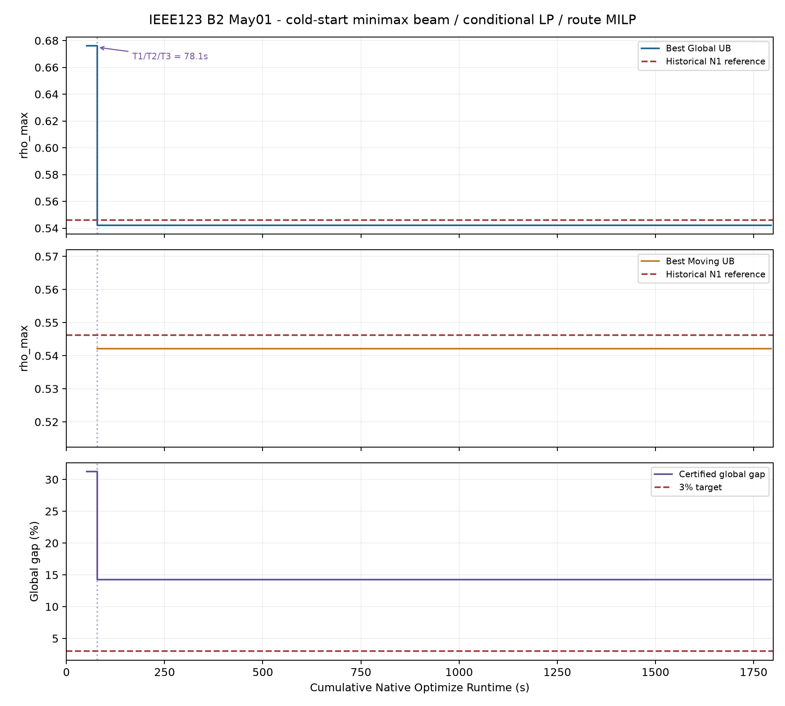
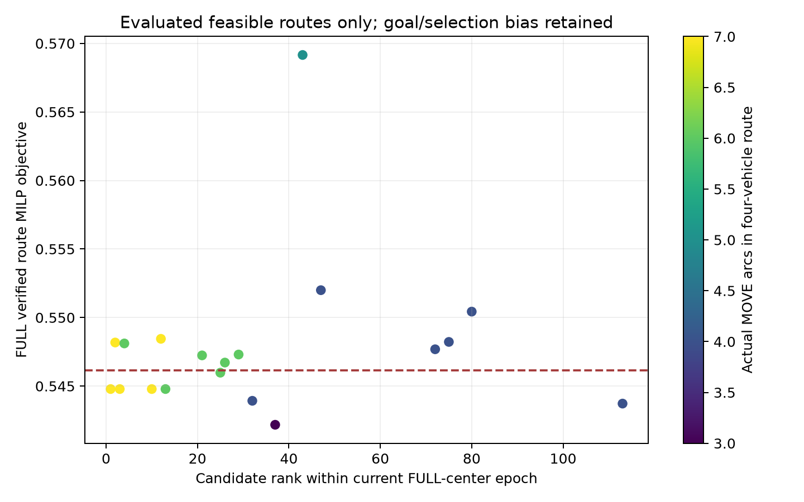
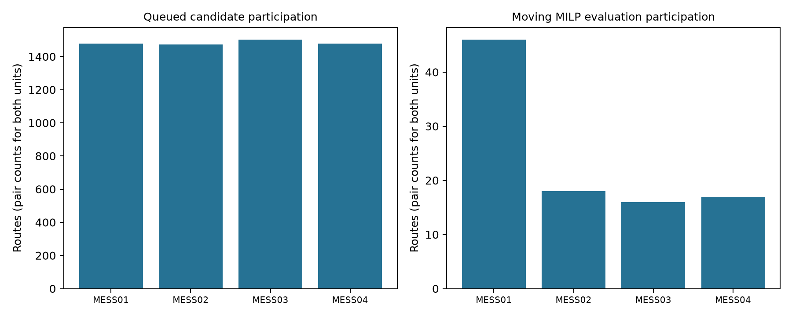

# V42 B2 Minimax Beam 1,800초 — 최종 연구 보고서

BEST_GLOBAL_UB = **0.5421769340794683**, BEST_MOVING_FEASIBLE_UB = **0.5421769340794683**. 인증 Global LB = **0.46498486997548166**, Global Gap = **14.237430%**. 실제 Native 누적 **1795.024999초**, Controller Wall **3963.407초**. 종료 사유 `NATIVE_BUDGET_END`. 분류는 **Certified Matheuristic / Bound-Guided Anytime MILP**이며 전체 이동경로 전역 최적성을 입증하지 않았다. ACTUAL_NOT_RUN.

|지표|PR218|신규 Canary|
|---|---|---|
|T1 Native seconds|103.44700002670288|78.05299997329712|
|T2 moving Native seconds|925.3799998760223|78.05299997329712|
|T3 strict moving improvement|NOT_REACHED|78.05299997329712|
|Moving MILP calls to first baseline match|23|1|
|Route MILP calls|54|56|
|Moving FULL feasible|53|19|
|Best Global UB|0.5461621302242249|0.5421769340794683|
|Best Moving UB|0.5461621302242249|0.5421769340794683|
|Certified Global LB|0.46498486997548166|0.46498486997548166|
|Global gap (%)|14.863216571865976|14.237430486607977|
|Native seconds|1795.0209996700287|1795.0249993801117|
|Controller wall seconds|4117.777109299903|3963.406836100039|

## 1. PR218 분석과 변경
PR218의 53개 FULL 가능 경로에서 기존 합산 Score와 실제 rho의 Spearman = 0.761762; 높은 gain 점수가 높은 rho와 연관됐다. 첫 네 평가가 모두 MESS01이고, 동일 기준 UB 경로는 28/53이었다. 실제 ETA별 병목 슬롯 관계는 `PR218_READONLY_FAILURE_ANALYSIS.json`에 보존했다. 새 정책은 공동 최대 행 부하, 시간 선행성, SOC 회복, 차량 다양성, 교차 협조 조합을 사용한다. 상관관계는 인과 증명이나 다른 날짜 성능 증거가 아니다.

## 2. N1 선행 단계 제거
Cold → 이동 Beam → 조건부 LP → 선택 경로 Exact C3A+Dense MILP → 원본 FULL Replay 순서다. 별도 N1 선행 Optimize는 0회. STAY 비교군 호출은 0회다. 이 비교군을 호출한다면 원본 N1과 수학적으로 같은 문제이며 Native 300초 이후 및 이동 기준 도달 전이라는 정책을 적용한다. 이번에는 첫 이동 모델이 기준을 이미 개선해 비교군 없이 이동 평가를 계속했다.

## 3. Cold Start와 과거 점 미사용
모든 신규 Native 모델의 historical MIP Start는 0개다. Source 권위점은 Native0 대수 회귀 검증에만 읽었으며 신규 UB로 등록하거나 solver start로 전달하지 않았다. 신규 Cold FULL UB는 0.6760534504652341. 유효한 Cold 가능해 후 U4를 호출하지 않았다. 증거: `PRE_NATIVE0_REGRESSION.json`, 각 `NATIVE_CALL.json`의 initial_point/actual_NumStart, `MODEL_IDENTITY.json`, 원본 Replay.

## 4. Minimax Beam과 Label
Beam64, 차량당 MOVE 깊이3은 heuristic 탐색 정책이다. Label은 Site/Slot/누적 실제 이동에너지/SOC 상계/잔여 충전 기회/실제 재접속/임계 행 벡터/서비스 시간창/MOVE 수/원본 Arc 경로를 갖는다. Score = Current FULL UB − max(고정 주입 기준부하 + 차량별 경로 조건 PCS 공급 추정 + 96슬롯 회복 부하 추정)이며 실제 UB나 유효 하한이 아니다. 부분 경로는 실제 원본 Arc의 depart/connect로 도달 가능한 미래 Site의 optimistic envelope를 사용한다. 미래 행마다 별도 선택하므로 정확한 dominance 주장도 없다.

## 5. SOC·Rebound Look-ahead
원본 440–1080kWh, 초기/종단760kWh, eta_ch=eta_dis=0.95, dt=0.25, P300, PCS400을 유지한다. 완성 경로 점수는 시간순 PCS 공급, 방전 효율 및 SOC 가용량, 저부하 연결 충전창과 종단 회복을 추정한다. 추정 SOC의 clamp는 순위용 내부 상태에만 적용하며 Native Raw에는 적용하지 않았다. 회복은 slot0–95 내에서만 계상한다. 원본 Arc domain과 최대 충전을 허용해도 부족한 SOC 필요조건만 물리적 hard pruning이며, 나머지 Beam/깊이/그룹 제거는 heuristic이다.

## 6. 조건부 LP 포함관계
Original FULL CSR에서 연결 P/Q, Mode gate, PCS16, SOC96 점화식, 초기/종단 SOC의 모든 197,116개 행과 27,599개 power/SOC/Mode/rho 열을 직접 추출했다. 원본 경로 Arc의 literal0/1은 RHS에 정확히 대입한다. 384개 Mode만 B→C로 완화하고 기타 Grid 행을 생략한다. 선택 임계 열·행은 독립 recursive helper elimination으로 원본 고정 AIDC 상수를 유지하여 재구성했다. 이진64 계수의 정확한 Fraction 오차를 변수 box에서 지지함수로 상계하고 RHS를 바깥 방향으로 반올림하므로 FULL 경로 고정 MILP 가능영역의 projection이 LP에 포함된다. 증거: `lp_template/INDEPENDENT_SOURCE_REEXTRACTION.json`, epoch별 independent_source_projection, LP Native Readback. LP 해는 FULL UB가 아니다.

## 7. LP 실측 Gate
LP 8회, Native 0.920000초, 추가 LP Worker Wall 153.065초, 정확한 제외 0개. Gate = `{'PASS': True, 'observed': {'median_Native': 0.11349999904632568, 'median_build_wall': 15.739813050022349, 'certified_ratio': 1.0, 'prune_ratio': 0.0, 'median_MILP_minus_LP': 0.07233708560710908}, 'disabled': True, 'preregistered': True, 'released_budget': 239.07999992370605}`. first8 사전등록 기준으로 느린 build/runtime 또는 약한 하한이면 중단하고 미사용 예산을 MILP에 돌린다. 유효한 실제 dual Pi의 부호와 finite-box 잔차를 정확한 dyadic weak duality로 검증하고 offline으로 재계산했다. TIME_LIMIT/LP incumbent만으로 경로를 제거하지 않았다. 경로별 bound는 Global LB로 승격하지 않았다. 관련 파일 `LP_SCREENING_PERFORMANCE.json`.

## 8. Route-Fixed Exact MILP
총 Route MILP 56회, 실제 이동 56회, FULL 가능 이동 19회. 4대 Mode384, 모든 Pch/Pdis/Q/SOC97과 전 원본96 Grid/PCS/SVR/Cap/AIDC를 최적화했다. Node/Arc/Flow/Alias는 실제 원본 이동경로로 고정하며 Native Readback 전에는 Optimize를 실행하지 않았다. pilot unrestricted, 이후 4회 중3회 rho≤현재UB−1e−5 목표, 1회 unrestricted 정책이다. goal INFEASIBLE은 경로 자체의 물리적 불가능성으로 해석하지 않았다. 상태: `{'FULL_FEASIBLE_MOVING': 19, 'IMPROVEMENT_GOAL_INFEASIBLE_NOT_PHYSICAL_INFEASIBLE': 36, 'TIME_LIMIT_NO_FULL_FEASIBLE': 1}`.

## 9. 역사적 N1 UB 도달시간
T1 = 78.05299997329712, T2 이동 = 78.05299997329712, 정차 비교군 최초 기준 도달 = NOT_REACHED Native초. 과거 UB 0.5461621302242249는 비교 기준만 사용했다. raw 발견의 누적 Native, FULL 검증 시점 누적 Native 및 Controller Wall은 `COLD_START_BENCHMARKS.json`에 분리돼 있다. 이전 결과의 시간0 복사는 없다.

## 10. 이동 개선 판정
T3 strict 이동 개선 = 78.05299997329712. 유의 개선 기준1e−5, 실질 개선 기준0.005. 최선 이동의 역사적 UB 감소 = 0.003985196144756564. 실질 개선 최초 시간 = NOT_REACHED. 미도달은 NOT_REACHED로 보고한다.

## 11. UB/Gap 궤적
FULL 통과 점만 갱신했고 동일 UB는 새 ranking center로 반복 사용하지 않았다. Global Gap=(Best Global UB−K48 LB)/UB. 목표3% 인증은 False. 조건부 LP 및 제한 MILP ObjBound는 이 Gap에 쓰지 않았다.

## 12. 실제 이동경로
|MESS|출발지|depart|도착지|arrive|connect|kWh|원본 Arc|
|---|---|---|---|---|---|---|---|
|MESS03|STA08|4|IDC06|6|7|21.904604877304664|4954|
|MESS03|IDC06|69|IDC05|71|72|23.09021491843033|40511|
|MESS03|IDC05|81|IDC01|83|83|21.31366187031675|47108|

다른 차량의 STAY와 원본 slot96 terminal 위치를 포함한 완전한 순서는 `BEST_MOVING_PLAN_AUDIT.json`에 있다. origin 복귀 조건을 새로 넣지 않았다.

## 13. 96슬롯 운전계획
`BEST_GLOBAL_96_SLOT_MESS_PLAN.csv` 및 `BEST_MOVING_96_SLOT_MESS_PLAN.csv`는 4대×96=384행의 원본 Pch/Pdis/Q/Mode/SOC before/after/실제 Arc/ETA/이동 debit을 제공한다. SOC 경계97개는 PLAN_AUDIT에 모두 보존한다. Raw를 rounding/clipping/repair하지 않았다.

## 14. Critical Line/Phase/Slot 변화
새로운 전96슬롯 원본814,560 security 행을 재스캔했다. Cold 최대 행 = `{'original_row': 507770, 'name': 'line_thermal_face[31,26,1]', 'family': 'line_thermal_face', 'slot': 31, 'metadata': {'family': 'line_thermal_face', 'slot': 31, 'index': 26, 'asset': 'line.l10', 'phase': 'A', 'facet': 1, 'unit': 'thermal_loading_pu', 'scale': 1.0, 'normalization_basis': 'original line utilization normalized rating=1'}, 'raw_violation': 2.220446049250313e-16, 'normalized_violation': 2.220446049250313e-16, 'priority_scale': 1.0, 'rho_scaled_loading': 0.6760534504652344}`. Best Global 최대 행 = `{'original_row': 393724, 'name': 'line_thermal_face[19,26,15]', 'family': 'line_thermal_face', 'slot': 19, 'metadata': {'family': 'line_thermal_face', 'slot': 19, 'index': 26, 'asset': 'line.l10', 'phase': 'A', 'facet': 15, 'unit': 'thermal_loading_pu', 'scale': 1.0, 'normalization_basis': 'original line utilization normalized rating=1'}, 'raw_violation': 3.3306690738754696e-16, 'normalized_violation': 3.3306690738754696e-16, 'priority_scale': 1.0, 'rho_scaled_loading': 0.5421769340794687}`. Best Moving 최대 행 = `{'original_row': 393724, 'name': 'line_thermal_face[19,26,15]', 'family': 'line_thermal_face', 'slot': 19, 'metadata': {'family': 'line_thermal_face', 'slot': 19, 'index': 26, 'asset': 'line.l10', 'phase': 'A', 'facet': 15, 'unit': 'thermal_loading_pu', 'scale': 1.0, 'normalization_basis': 'original line utilization normalized rating=1'}, 'raw_violation': 3.3306690738754696e-16, 'normalized_violation': 3.3306690738754696e-16, 'priority_scale': 1.0, 'rho_scaled_loading': 0.5421769340794687}`. 전압/NormalAmps/Transformer도 FULL에 포함되며 `CRITICAL_GRID_ANALYSIS.json`에서 확인한다.

## 15. Rebound 실측
충전 증가를 신규 COLD 대비 계산했고 최선 이동의 실제 제한 asset에서 원본 signed P/Q 계수로 부하 증가 기여를 재산출했다. Cold는 Mode가 고정된 점이므로 이 차이에는 Mode/P/Q 재최적화 효과도 포함되며 이동에너지 전용 Rebound의 인과 분리 증거로 해석하지 않는다. 이는 역사적 N1 Raw를 현재 점으로 복사한 비교가 아니다. `REBOUND_ANALYSIS.json`에 slot별 결과와 source-row SHA가 있다. 종단 SOC와 이동 중 P/Q=0 조건은 원본 Replay로 확인했다.

## 16. Native·Wall·메모리
총 Native 1795.024999초 ≤1,800, budget reset0, 모델 생성·FULL Replay wall 별도. 한 heavy worker, Threads1, GPU 미사용. 관측 최소 RAM 가용 12.575GiB, Commit 가용 30.329GiB. 모든 Model Build 후 actual growth reserve를 추가 승인하고 callback에서 확인했다. 원본 수치 경고 65개를 숨기지 않았으며 `MEMORY_NUMERIC_AUDIT.json`에 보존했다.

## 17. 원본 FULL 독립 검증
Native worker 종료·모델 dispose 후 별도 validator process에서 원본 CSR/RHS/Sense, 원본 binary/integer literal, Alias/DAG/ETA/energy, Mode/PCS, SOC 초기/종단, 계통96, objective를 검증했다. Native Raw와 exact objective SHA는 각 Replay에 결합됐다. 허용오차를 바꾸지 않았으며 실패 Raw도 보존했다. 원본 FULL PASS는 Fresh OpenDSS AC PASS를 뜻하지 않는다. `FULL_REPLAY_CERTIFICATES.json`, `FINAL_INDEPENDENT_REVIEW.json` 참조.

## 18. K32/K48 인증 계승
동일 Source/Case/Matrix/Domain 및 기존 모델·계수 파일 SHA를 다시 확인했다. K32=.46497617639758426, K48=.46498486997548166. 신규 LB 강화 Optimize0회, K48를 Global LB로 유지했다. `K32_K48_LB_CERTIFICATES.json` 참조.

## 19. PR218 대비 효율
Score–actual rho Spearman = -0.3723301494638019; goal 성공 표본과 선택 편향을 포함한다. 첫 기준 이동 UB까지 평가한 이동 MILP는 PR218 23회→신규 1회지만 전체 호출은 54→56회로 감소하지 않았다. 동일 UB 반복 0/19, 정확한 LP 제외 0, heuristic 순위 후순위 12442, Beam label 제거 817799. 변경 차량별 평가 수 `{'MESS03': 16, 'MESS01': 46, 'MESS04': 17, 'MESS02': 18}`이며 MESS01 편향이 남았다. 후보 재접속·임계 슬롯 비교 비율은 0.333355; 이는 모든 실제 MOVE와 해당 epoch 임계 슬롯의 쌍에서 connect≤critical slot 비율이다. 출발/도착 시간대 분포는 `MOVING_FEASIBILITY_DIAGNOSTICS.json`에 있다. 적은 호출 자체를 개선으로 주장하지 않고 위 T1/T2/T3와 동일 Native 예산 UB를 비교한다. May01 사후 설계이므로 May02/03 일반화 성능은 검증하지 않았다.

## 20. 채택 판단과 한계
**추가 독립 날짜 검증 전 일반 채택 보류**. LP Gate 및 관측 실패는 그대로 보고한다. 전체 경로 공간을 탐색하거나 전역 최적성을 입증하지 않았다. 3% 미달이면 실제 Gap을 유지한다. B1/B3/IEEE8500/다른 날짜/May 캠페인 Optimize0회, 예약 task와 automations를 변경하지 않았다. 이전 PR218 및 Scientific Source/Native ledger는 읽기 전용으로 보존했다.
