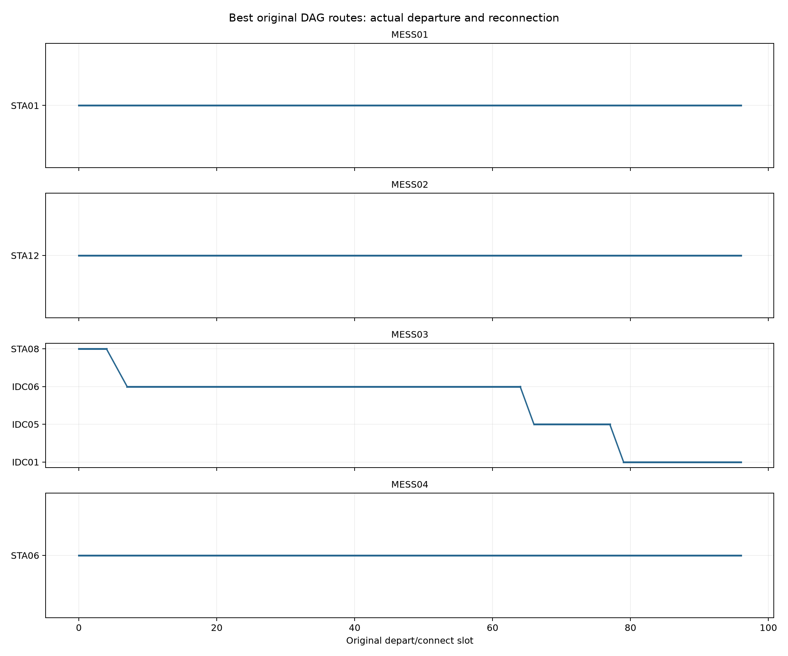
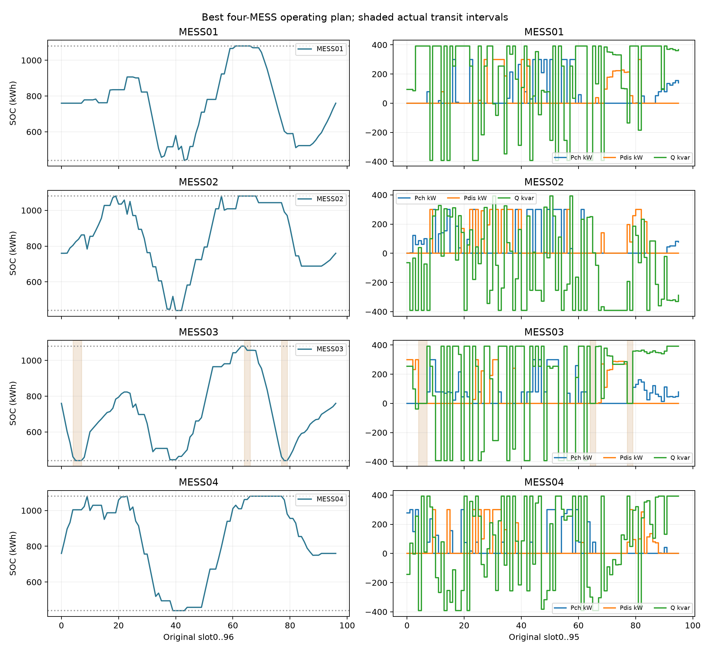
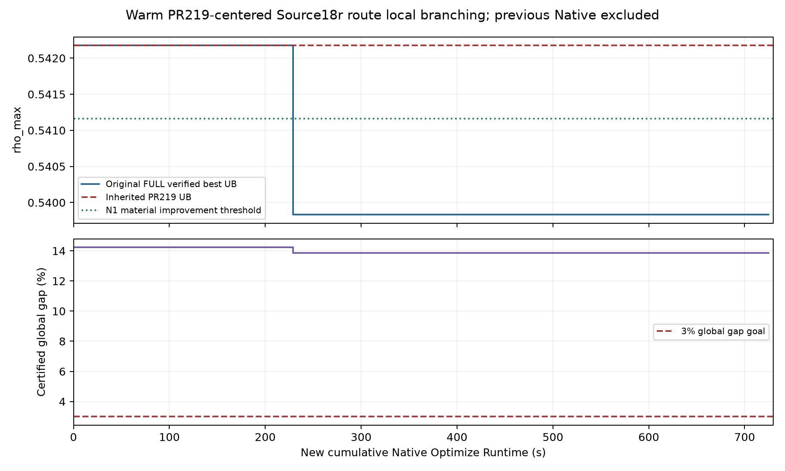

# V42 B2 Route-Centered Local Branching — 신규 Native 최대1,800초 Warm Canary

BEST_GLOBAL_UB **0.53983102263386951**, BEST_MOVING_FEASIBLE_UB **0.53983102263386951**. PR219 대비 UB 감소 **0.0023459114455988139**, N1 대비 **0.0063311075903553782**. 신규 Native **724.821000초**, Controller Wall **1889.287초**. K48 인증 Global Gap **13.864737209%**, ACTUAL_NOT_RUN. 종료 `NONREPEATING_NEIGHBORHOODS_EXHAUSTED`. 분류는 **Certified Matheuristic / Bound-Guided Anytime MILP**이며 원본 전역 경로 최적성을 주장하지 않는다.

## Warm Authority 및 과거 시간 분리
PR219 exact HEAD `ca2c050c5481e64d560ed35f5a03e30c9fffb829`, raw SHA `6c24f3610df3d02188eb49b2473db43772b971f22dcf30c80c2c9aa492ba728a`, vector SHA `beb1f93db4bbb1a0092685d78f6079c377b0823b049358e5d8c630f62c5f0952`. 초기 UB 0.5421769340794683, Native0 원본 FULL 재검증 PASS. PR219 과거 Native1795.025초 및 발견78.053초는 이번 예산에 합산하지 않았다. 이번 초기 point는 inherited Native0 기준점이며 신규 발견시간0이라는 cold 성과가 아니다. 초기 Raw의 약5e−13 상한 잔차는 원본 숫자 허용오차 내로 그대로 유지하고 clipping/rounding/repair하지 않았다. A0 재최적화0회, N1/U4/Cold 실행0회.

## 성능 비교
|Algorithm|FULL Verified UB|Moves|Native(s) scope|Global Gap(%)|
|---|---|---|---|---|
|Historical N1|0.5461621302242249|0|PR218 past 21.916 (N1 only)|14.863216571865976|
|PR219 Minimax Beam|0.5421769340794683|3|Past capture78.053 / total1795.025|14.237430486607977|
|3-MOVE Ablation Best|0.5421769300967868|3|146.54099988937378|14.237429856619903|
|R1/R2 Route Local Branching|0.5398310226338695|3|131.28499960899353|13.86473720854514|
|R3 Whole MESS03|0.5398310226338695|3|258.35400009155273|13.86473720854514|
|R4 Two-MESS|0.5398310226338695|3|48.88799977302551|13.86473720854514|
|R5/Adaptive|0.5398310226338695|3|139.7530002593994|13.86473720854514|
|Final Best|0.5398310226338695|3|724.820999622345|13.864737208545142|

단계 best가 기존 seed와 같으면 새로운 개선으로 계산하지 않는다. 최초 유의 개선 = **229.208000초 (R2_LATE_SMALL)**, 최초 MATERIAL_VS_N1 = **229.208000초 (R2_LATE_SMALL)**, 개선 횟수 1, 최선 발견 신규 Native 229.208000초. 원시 발견시간과 FULL 검증 시점 Native/Wall을 각 event에 분리했다. 유의 기준1e−5, UB 비교 허용1e−8, MATERIAL threshold 0.5411621302242249는 서로 다르다.

## 수학적 제한 및 Source 보존
원본9322 Binary, 4대/24 Site/96슬롯, ETA·이동에너지·초기/종단SOC·PCS16·고정AIDC·전체Voltage/NormalAmps/Transformer/Thermal/SVR/Cap 및 min rho_max를 유지했다. Source207·Case·FULL Matrix/Domain SHA는 SOURCE_CASE_AUTHORITY.json에 결합돼 있다. 원본CSR/RHS/Sense/types/objective를 그대로 만들고 Route bounds fixation과 Hamming 검색 row만 추가했다. 원본 FULL 가능영역의 제한 부분집합이므로 restricted ObjBound를 Global LB로 승격하지 않는다.

모든384 Mode와 Pch/Pdis/Q/SOC97은 원래 bounds에서 재최적화했다. Hamming은 자유 Route Node만 포함한다. Radius는 실제 다른 moving witness의 거리+사전등록 slack이다. RouteClosure는 실제 center vertex에서 잘라 Source Arc의 forward/backward 연결, 후속STAY/Flow 및 terminal96을 연다. Site/시간창은 heuristic이며 원본 전체 경로 공간의 정확한 prescreen이 아니다. 닫힌 원본 Arc/Node Alias를 별도로 정확 전개해 누수0을 확인했다. center는 original FULL PASS, fixing/Hamming literal PASS 및 unchanged raw MIP Start readback으로 검증했다. 원본validator 수치범위를 exact dyadic primal certificate로 과장하지 않는다. `ROUTE_NEIGHBORHOOD_CONTRACT_KO.md`, `ROUTE_DAG_CLOSURE_AUDIT.json`, `NATIVE_MODEL_READBACK.json` 참조.

## 3-MOVE Ablation
A0는 이미 인증된 기존 point이므로 동일 MILP를 호출하지 않았다. A1/A2는 MOVE삭제 후96슬롯완성DAG로 재구성했고 A3/A4/A5는 실제 출발시각/목적지/후속연결을 변경했다. A6는 첫MOVE 유지 후 다른 차량을 추가했다. 경로가 달라진 진단에는 모순되는 PR219 Raw Start를 넣지 않았다. 각 UB/충전·방전 AC kWh/이동에너지/SOC/충전증가/임계Line·Phase·Slot은 `THREE_MOVE_ABLATION.json`에 있다. 목적값 차이는 모든4대의 공동 재최적화 결과이며 개별MOVE의 독립 인과효과로 단정하지 않는다.

## Local Branching 실제 반복
|Iteration|FULL UB|Native(s)|Status|Nodes|Root done|Restricted gap|R|Free B|Fixed B|
|---|---|---|---|---|---|---|---|---|---|
|A1_FIRST_MOVE_ONLY|0.5483835054439078|25.449000120162964|2|1.0|True|0.0|None|384|8938|
|A2_FIRST_TWO_MOVES|0.5458147632943413|24.164999961853027|2|1.0|True|0.0|None|384|8938|
|A3_FIRST_DEPARTURE_CHANGED|0.5421769300967868|27.168999910354614|2|1.0|True|0.0|None|384|8938|
|A4_FIRST_DESTINATION_RECONNECTED|0.5455350519936504|24.22099995613098|2|1.0|True|0.0|None|384|8938|
|A5_SECOND_MOVE_RETIMED|0.5421931794129506|26.7739999294281|2|1.0|True|0.0|None|384|8938|
|A6_FIRST_MOVE_PLUS_MESS01|0.549096951622615|18.763000011444092|2|1.0|True|0.0|None|384|8938|
|R1_FIRST_SMALL|0.5421769340794683|19.94599986076355|2|1.0|False|1.35218917704187e-08|36|447|8875|
|R2_LATE_SMALL|0.5398310226338695|62.72099995613098|11|1.0|True|0.002764312787310174|57|520|8802|
|R1_FIRST_EXPANDED|0.5398310226338695|12.705999851226807|2|0.0|False|0.0|66|567|8755|
|R2_LATE_EXPANDED|0.5398310226338695|35.91199994087219|2|1.0|False|0.0033851430736905872|72|660|8662|
|R3_WHOLE_MESS03_FOUR_SITES|0.5398310226338695|37.14300012588501|2|1.0|False|0.0027643421247636243|190|758|8564|
|R3_WHOLE_MESS03_24_SITES|0.5398310226338695|221.21099996566772|9|1.0|False|0.46390540937516733|209|2622|6700|
|R4_MESS03_MESS01|0.5398310226338695|16.17799997329712|2|0.0|False|0.0|341|1227|8095|
|R4_MESS03_MESS04|0.5398310226338695|16.072999954223633|2|0.0|False|0.0|307|1227|8095|
|R4_MESS03_MESS02|0.5398310226338695|16.63699984550476|2|0.0|False|0.0|343|1227|8095|
|ADAPTIVE_POST_GAIN_CORRIDOR_0|0.5398310226338695|16.56000018119812|2|0.0|False|0.0|349|1320|8002|
|ADAPTIVE_POST_GAIN_CORRIDOR_1|0.5398310226338695|18.42899990081787|2|0.0|False|0.0|325|1601|7721|
|ADAPTIVE_POST_GAIN_CORRIDOR_2|0.5398310226338695|23.96399998664856|2|0.0|False|0.0|369|1883|7439|
|ADAPTIVE_POST_GAIN_CORRIDOR_3|0.5398310226338695|24.282000064849854|2|0.0|False|0.0|375|2161|7161|
|ADAPTIVE_POST_GAIN_CORRIDOR_4|0.5398310226338695|27.242000102996826|2|0.0|False|0.0|349|2439|6883|
|ADAPTIVE_POST_GAIN_CORRIDOR_5|0.5398310226338695|29.276000022888184|2|0.0|False|0.0|393|2720|6602|

TIME_LIMIT/NUMERIC/USER 또는 RESOURCE STOP을 보존했다. 새 FULL 유의 개선만 중심을 바꿨고 동일UB point로 반복 중심갱신하지 않았다. 동일 수학적 bounds/Hamming signature를 재실행하지 않았다. R2에서 유의 개선이 나왔으므로 이번 실행의 Beam 호출은 0회다. 사전등록 정책에 따라 예비 6개 corridor를 새 중심의 ADAPTIVE 단계로 실행했다. 기존 56개 route-fixed 평가를 재시작하지 않았다. R4는 MESS01/02/04와의 쌍을 original signed grid 순위로 각각 시도했다. ROOT 미완료/열린 영역의 solver gap은 원본Global gap이 아니다.

## 핵심 질문과 증거 범위
- Q1/Q6: 최종 UB 0.53983102263386951, PR219 대비 감소 0.0023459114455988139. 최초 신규 유의 개선 229.208000 신규 Native초 (R2_LATE_SMALL).
- Q2: A1의 UB는 0.5483835054439078, A2는 0.5458147632943413로 A0보다 각각 높았다. 이 변경 가족에서는 후반 이동을 없애면 4대 공동 재최적화 성능이 나빠졌다. 첫 MOVE를 제거한 대조는 없으므로 첫 MOVE 자체의 인과 중요성을 확정하지 않는다. 후반 MOVE의 독립 인과효과도 아니다.
- Q3: A3는 0.5421769300967868로 수치 허용 안의 동일값, A4는 0.5455350519936504, A5는 0.5421931794129506였다. 추가 개선은 MILP가 후반 출발 64/77을 선택한 R2에서 나왔다. 한 가지 경로를 고정한 retiming과 자유 경로 선택의 결과는 다르다.
- Q4: R2의 MESS03 경로 변경이 실제 추가 개선을 만들었다. R3는 신규 Native 258.354000초, R4 세 조합은 48.888000초를 사용했고 모두 추가 개선은 없었다. R3의 큰 이웃은 TIME_LIMIT이므로 충분한 탐색에 대한 동등 비교나 전역 실패 증거가 아니다.
- Q5: 이 실행은 Warm Start이며 PR219 cold-start 시간과 직접 동일한 성능 지표가 아니다. 추가 UB 감소량과 신규 Native 비용만 비교한다.
- Q7: N1 대비 감소 0.0063311075903553782; MATERIAL_VS_N1 = True.
- Q8: K48 LB 0.46498486997548166, Global Gap 13.864737209%, 3% 인증 False.
- Q9: Root 완료/Native 시점, NodeCount 및 restricted MIPGap은 iteration 표에 보존한다. 미완료 root는 완료로 취급하지 않는다.
- Q10: 고정 corridor/선택 Site/Hamming의 제한과 관측 SOC/PCS/P300 포화는 별도 증거다. 이웃 전체가 제한 OPTIMAL이어도 원본 전체 전역 최적성을 증명하지 않는다. TIME_LIMIT은 개선 부재 증거가 아니다. 특정 원인에 대한 추가 인과 실험은 하지 않았다.

## 실제 최선 경로와 운전계획
|MESS|Source|Depart|Destination|Arrive|Connect|kWh|Original Arc|
|---|---|---|---|---|---|---|---|
|MESS03|STA08|4|IDC06|6|7|21.904604877304664|4954|
|MESS03|IDC06|64|IDC05|66|66|23.328662383890833|37751|
|MESS03|IDC05|77|IDC01|79|79|21.431159059228253|44900|

`BEST_96_SLOT_MESS_PLAN.csv`는4대×96=384행 Pch/Pdis/Q/Mode/SOC before/after/Arc/ETA/이동debit을 제공한다. `BEST_PLAN_AUDIT.json`은97SOC경계/초기종단/포화범위/실제이동과 원본terminalSite를 제공한다. 새return-to-origin의무를 추가하지 않았다.

## Critical Grid·Rebound 및 제약 포화
초기 및최선의 original814,560security행을 재스캔했다. PR219 제한행 `{'original_row': 393724, 'name': 'line_thermal_face[19,26,15]', 'family': 'line_thermal_face', 'slot': 19, 'metadata': {'family': 'line_thermal_face', 'slot': 19, 'index': 26, 'asset': 'line.l10', 'phase': 'A', 'facet': 15, 'unit': 'thermal_loading_pu', 'scale': 1.0, 'normalization_basis': 'original line utilization normalized rating=1'}, 'raw_violation': 3.3306690738754696e-16, 'normalized_violation': 3.3306690738754696e-16, 'priority_scale': 1.0, 'rho_scaled_loading': 0.5421769340794687}`; 최종 `{'original_row': 612457, 'name': 'line_thermal_face[42,33,0]', 'family': 'line_thermal_face', 'slot': 42, 'metadata': {'family': 'line_thermal_face', 'slot': 42, 'index': 33, 'asset': 'line.sw2', 'phase': 'A', 'facet': 0, 'unit': 'thermal_loading_pu', 'scale': 1.0, 'normalization_basis': 'original line utilization normalized rating=1'}, 'raw_violation': 3.3861802251067274e-15, 'normalized_violation': 3.3861802251067274e-15, 'priority_scale': 1.0, 'rho_scaled_loading': 0.539831022633873}`. 초기검증point 대비 충전증가 84개 기록과 원본signed P/Q의 실제제한asset 부하 기여를 `REBOUND_AND_SATURATION_ANALYSIS.json`에 보존했다. Rebound를96밖으로 옮기거나종단SOC를완화하지 않았다. Mode/P/Q재최적화가함께바뀌므로이동에너지의독립인과효과로해석하지않는다. SOC440/1080, P300, PCS400근접slot은관측포화증거이며원본전체전역최적성이나실패의유일원인을증명하지않는다.

## 자원·원장·독립 원본 FULL
신규 Optimize 21회, 전체실제 Runtime합 724.821000초 ≤1800. 예산reset0, 과거Native별도. 사전등록한 21개 모델의 비중복 후보를 모두 실행해 조기 종료했다. 원본 전체 경로 공간을 소진했다는 뜻은 아니다. 같은 모델을 반복해 1,800초를 채우지 않았다. Threads1/heavyworker1, 모델생성후실측추가성장Reserve검증및callback확인. 최소가용RAM 13.971GiB, Commit 31.731GiB, 최대RSS 2.295GiB/PrivateCommit 3.805GiB. 경고21개를숨기지않았다. worker종료·dispose후원본FULL독립검증. PASS/FAIL Raw와 log를모두보존하며 tolerance변경·반올림·복구0. `FINAL_INDEPENDENT_REVIEW.json`에서 원장·Raw SHA/Vector/원본물리 및K32/K48 계승을다시검증했다.

## 최종 판단
추가개선 True, N1물질개선 True, GlobalGap3% False. 성능이개선되지않았으면그사실을유지하며global최적해로해석하지않는다. Warm지역탐색을coldBeam과동일지표로평가하지않는다. 추가LB/FreshOpenDSS/Actual/PQrepair/B1/B3/IEEE8500/다른날짜/공식May31campaign0회. 기존HOLD/DisabledTask/Source/PR219/NativeLedger를그대로보존했다. ACTUAL_NOT_RUN.

## 최종 수치 상세 및 해석

|차량|MOVE|이동 kWh|충전 AC kWh|방전 AC kWh|SOC min|SOC max|초기 SOC|종단 SOC|
|---|---|---|---|---|---|---|---|---|
|MESS01|0|0.000000|1259.744820|1136.919700|440.0|1080.0|760.0|760.0|
|MESS02|0|0.000000|1427.304522|1288.142331|440.0|1080.0|760.0|760.0|
|MESS03|3|66.664426|1448.186400|1243.657021|440.0|1080.0|760.0|760.0|
|MESS04|0|0.000000|1247.562880|1125.925499|440.0|1080.0|760.0|760.0|

총 이동에너지는 66.664426320 kWh로 PR219의 66.308481666 kWh보다 증가했다. UB 개선을 이동에너지 절감으로 설명할 수 없다. 원본 ETA와 에너지를 사용하면서 4대의 P/Q/Mode/SOC를 함께 재최적화한 결과다. 초기 임계 Line/Phase/Slot은 line.l10/A/19, 최종은 line.sw2/A/42다.

Q5의 비용 비교: 기존 PR219는 cold 탐색 1,795.025 Native초를 사용했다. 이번 warm 탐색은 229.208초에서 추가 UB 감소 0.0023459114를 인증했고, 전체 724.821초를 사용했다. 이 실행에서는 더 낮은 UB를 얻었지만 동일 초기조건의 반복 비교가 아니므로 일반적인 알고리즘 효율 우위를 증명하지 않는다.

Q9의 실제 관측: R2_LATE_SMALL은 Root를 해당 호출의 28.370 Native초에 완료했고 NodeCount 1, 종료 restricted MIPGap 0.276431%였다. R3의 24-Site 모델은 TIME_LIMIT, NodeCount 1, restricted MIPGap 46.390541%로 종료했으며 Root 완료 로그가 없다. 나머지 완료 판정과 시간은 LOCAL_BRANCHING_ITERATIONS.json에 보존했다. OPTIMAL은 원본 MIPGap 0.005 정책에 따른 제한 문제의 solver 상태이며 정확한 전역 최적성 인증이 아니다.

신규 Raw FULL Replay: PASS 27개, FAIL 1개. 최초 개선 callback Raw는 STRICT_LITERAL_INTEGER_GATE_FAILED로 거절했다. 이를 반올림하거나 복구하지 않았으며 동일 호출의 FINAL_RAW가 원본 FULL PASS 후 최선 해로 채택됐다. 독립 재검증의 추가 Optimize는 0회다.

Native worker 최대 Peak RSS 2.294582 GiB, Private Commit 3.805130 GiB. 시스템 전체의 샘플링 중 최대 RAM 사용 17.739887 GiB, Commit 총사용 31.980003 GiB다. 시스템 수치는 샘플 사이의 연속 peak를 보장하지 않는다.
